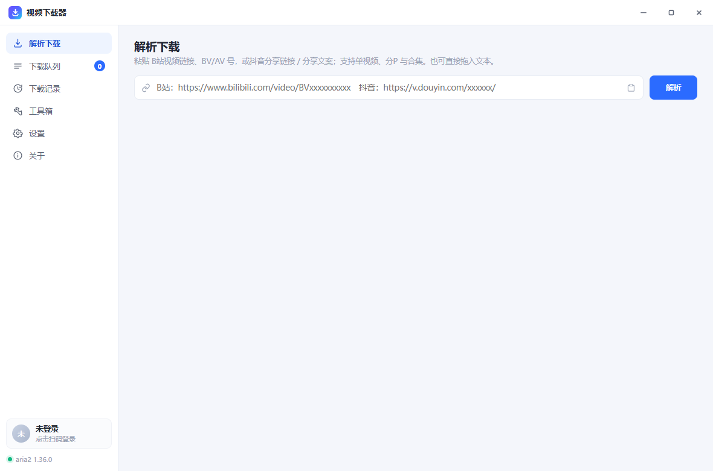
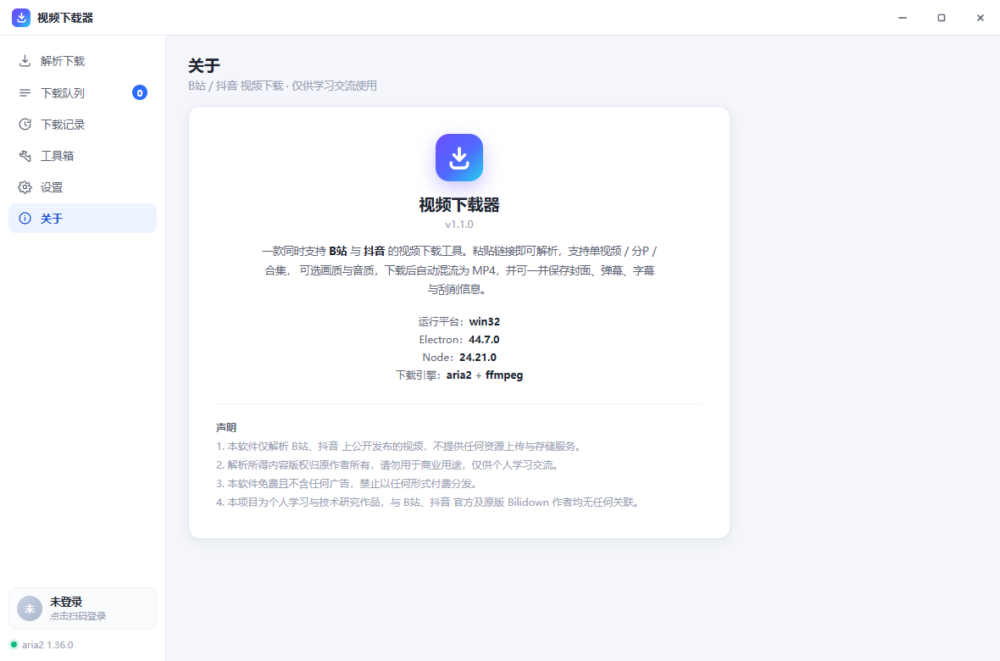
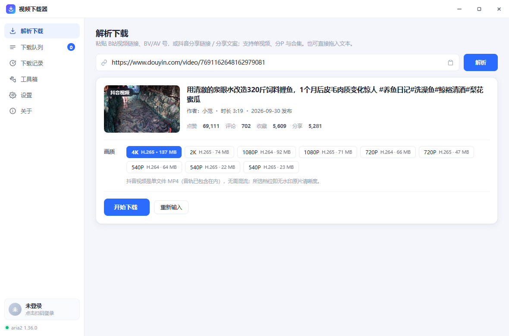
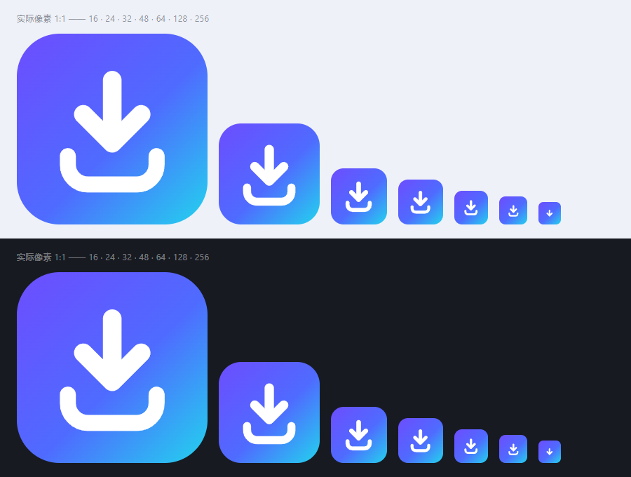

# 微光视频下载器

一款同时支持 **B站** 与 **抖音** 的视频下载工具（界面里的名字就叫「微光视频下载器」）。
零构建链、依赖极少、源码即程序。

> 命名沿革：**BiliDown-Next**（只支持 B站）→ **视频下载器**（加入抖音后改的通用名）→
> **微光视频下载器**（2026-10-13 定名，取自开发者笔名「微光照前行」）。图标也从字母 B 换成了
> 通用的「下载」符号。**老配置会自动迁移、不会丢**（见下方「关于改名」）。



---

## 与原版的核心差异

| | 原版 Bilidown | 本实现 |
|---|---|---|
| **平台支持** | 仅 B站 | **B站 + 抖音**（抖音为无水印直链原片） |
| **前端框架** | Vue2 + Element（需 webpack 构建） | 原生 HTML/CSS/JS，改完即生效 |
| **进程安全** | 渲染进程开启 `nodeIntegration`，页面被注入即等于交出系统权限 | `contextIsolation` + 白名单 IPC，渲染进程无法直接触碰文件系统 |
| **接口签名** | 无 WBI 签名，wbi 系接口易被风控降级 | 完整实现 WBI 签名（`w_rid` / `wts`） |
| **设备指纹** | 无 | 主动获取 `buvid3/buvid4` 并写入 session，避免 `-352` 风控 |
| **Cookie 管理** | 手工拼装 Header | 由 Electron session 自动持有与携带 |
| **弹幕获取** | 依赖浏览器网络栈解码（易 `ERR_CONTENT_DECODING_FAILED`） | 用 Node 直连，自行解压 deflate，稳定可控 |
| **合集解析** | 读取旧字段 `sections[].archives` | 兼容 B站新版 `sections[].episodes`（旧字段仍可用） |
| **文件名长度** | 未做限制，超长标题会创建失败 | 自动截断，规避 Windows 260 字符路径上限 |
| **下载引擎** | 内置 aria2c + ffmpeg | 相同（复用同一套二进制，行为一致） |

---

## 快速开始

```text
双击  启动.bat
```

启动脚本**直接拉起 `node_modules\electron\dist\electron.exe`**，
不需要系统里装过 Node.js / npm（依赖已随项目内置）。

`安装依赖.bat` 只在 `node_modules` 缺失时才需要，且那是唯一一步需要 Node.js 的操作
（走淘宝镜像，首次会下载约 250MB 的 Electron 运行时；失败多半是网络问题，重跑即可）。

手动方式（需要 Node.js）：

```bash
npm install
npm start          # 等价于启动.bat
```

> **⚠ 首次运行前，`bin/` 里需要自备两个第三方可执行文件**（本仓库不收录二进制，见 `.gitignore`）：
>
> | 文件 | 放哪 | 去哪拿 |
> | --- | --- | --- |
> | `aria2c.exe` | `bin\` | <https://github.com/aria2/aria2/releases> （Windows 版，解压后取 `aria2c.exe`） |
> | `ffmpeg.exe` | `bin\` | <https://www.gyan.dev/ffmpeg/builds/> 或 <https://github.com/BtbN/FFmpeg-Builds/releases> |
>
> `bin\aria2c.conf` 已随仓库提供，无需另找。两者都是**独立可执行文件**，
> 放进 `bin\` 即可，不需要装到系统 PATH。

---

## 功能

**解析与下载（B站）**
- 单视频 / 分P（多P）/ 合集（UGC season）全支持，输入框可直接粘贴链接、BV 号、AV 号
- **合集页面链接直接可用**：`space.bilibili.com/<mid>/channel/collectiondetail?sid=…`（含其 `b23.tv` 分享短链）粘进来即可解析出整个合集，无需手动去找某一集的普通链接
- 自动展开 `b23.tv` 短链；支持把链接直接拖进窗口
- 画质 240P → 8K，音质 64K → Hi-Res 无损 / 杜比全景声（登录后解锁高画质）
- 视频轨与音频轨分别多线程下载（aria2，8 连接 / 分片），随后用 ffmpeg 无损混流为 MP4
- 并发数可调；支持暂停 / 续传 / 取消 / 单任务重试
- 流地址在任务真正开始时才获取，规避 B站 URL 约 2 小时的时效限制

**解析与下载（抖音）**
- 粘贴分享链接、分享文案、长短链接，或直接填作品 ID 均可
- 自动展开 `v.douyin.com` 短链，识别 `/video/`、`/note/`、`?modal_id=` 等形态
- **下载的是无水印原片**；按 1080P / 720P / 540P 分档，每档标注编码与体积
- 单文件 MP4（音视频同轨），**不需要 ffmpeg 混流**，下完即可播放
- 同样支持并发、暂停 / 续传 / 取消 / 重试，以及封面 / NFO / 下载记录

**附加内容（可选保存）**
- 封面 `.jpg`
- 弹幕 `.xml`（原始） / `.ass`（可直接挂载播放器）—— 仅 B站
- CC 字幕 `.srt` —— 仅 B站
- NFO 刮削文件（Kodi / Jellyfin / Emby 可识别）—— 两个平台都支持

**账号**
- 扫码登录，登录后自动解锁高画质，显示昵称与会员状态

**其它**
- 自定义文件命名规则与文件夹规则（支持 12 个内置变量，可组合多级目录）
- 下载记录（保留最近 2000 条，可导出 JSON）
- 下载完成后自动关机（30 秒倒计时可取消）
- 监听剪切板链接、关闭最小化到托盘
- 工具箱：AAC → MP3 转换、音视频手动混流
- 右键菜单：输入框/文本框支持剪切、复制、粘贴、全选（解析框额外提供「粘贴并解析」）；
  下载队列卡片与下载记录行也各自带有右键菜单
- 启动时后台体检 B站 接口，疑似失效时在界面顶部给出提示与修复指引
  （仅"接口有响应但内容不对"才提示，断网/超时保持静默）

---

## 命名变量

| 变量 | 含义 | 变量 | 含义 |
|---|---|---|---|
| `{title}` | 视频标题 | `{uid}` | UP 主 / 作者 UID |
| `{bv}` | BV 号 | `{index}` | 分集序号 |
| `{av}` | AV 号 | `{part}` | 分集标题 |
| `{cid}` | cid | `{qn}` | 画质名称 |
| `{aweme}` | 抖音作品 ID | `{date}` `{time}` | 日期 / 时间 |
| `{up}` | UP 主 / 作者昵称 | `{type}` | 类型（单视频/分集/合集/抖音视频） |

示例：

- 文件名规则 `{date}_{title}` → `2026-10-09_视频标题.mp4`
- 文件夹规则 `{up}/{title}` → 按 UP 主（作者）分目录，再按视频标题建子目录
- 同时下载两个平台、想分开存放：文件夹规则填 `{type}/{up}`

---

## 目录结构

```text
VideoDownloader/           （原名 BiliDown-New，2026-10-10 改名）
├─ bin/                    aria2c.exe + ffmpeg.exe + aria2c.conf
├─ assets/logo.ico         图标（由 tools/make-icon.js 代码生成，非第三方素材）
├─ docs/                   界面截图
├─ data/                   ★ 程序数据（设置 / 下载记录 / 登录态 / 缓存）—— 运行时自动生成，不入库
├─ logs/                   运行日志 app.log —— 运行时自动生成，不入库
├─ src/
│  ├─ main/                主进程
│  │  ├─ main.js           窗口 / 托盘 / IPC / aria2 生命周期 / 启动体检 / 应用名
│  │  ├─ preload.js        contextBridge 安全桥
│  │  ├─ api.js            ★ 与 B站 / 抖音 的全部约定（接口地址/请求头/WBI 表/画质表）
│  │  ├─ bili.js           B站 API + WBI 签名 + 弹幕/封面抓取 + 接口体检
│  │  ├─ douyin.js         ★ 抖音解析（隐藏窗口 + CDP 抓包，绕过 Argus 风控）
│  │  ├─ resolver.js       链接解析（平台识别 + 单视频/分P/合集归一化）
│  │  ├─ downloader.js     任务队列 / 进度 / 混流 / 直链下载 / 收尾
│  │  ├─ aria2.js          aria2 JSON-RPC 客户端
│  │  ├─ ffmpeg.js         混流与转码
│  │  ├─ converters.js     弹幕→ASS / 字幕→SRT / NFO
│  │  └─ config.js         配置持久化与命名变量
│  └─ renderer/            渲染进程（无框架）
│     ├─ index.html
│     ├─ css/app.css
│     └─ js/app.js
├─ 安装依赖.bat
├─ 启动.bat
├─ 打包.bat                一键打包成绿色版（见下方「打包与分发」）
└─ 自检.bat                一键跑完下面 4 项自检（本机无需装 Node.js）
```

### 关于改名（BiliDown-Next → 视频下载器 → 微光视频下载器）

程序早期只支持 B站，叫 **BiliDown-Next**；加入抖音后成了通用下载器，改名 **视频下载器**；
2026-10-13 定名 **微光视频下载器**（取自开发者笔名「微光照前行」）。改的一直是**名字**，不是功能：

| | 旧名 | 现名 |
|---|---|---|
| 界面展示名 | BiliDown-Next → 视频下载器 | **微光视频下载器**（窗口标题 / 托盘 / 标题栏 / 关于页 / exe 名） |
| 项目文件夹 | `BiliDown-New` | `VideoDownloader` |
| 上级目录 | `B站下载` | `视频下载` |
| 用户数据目录 | `%APPDATA%\bilidown-next` → `%APPDATA%\video-downloader` | 程序同级 `data\`（见下节） |

> **改名不动数据目录**：展示名改成「微光视频下载器」后，数据目录仍是程序同级的 `data\`
> （常量 `DATA_DIR_NAME` 写死、不跟随展示名），登录态、设置、下载记录一个字都不会丢。

> 注意：源码注释与文档里仍有「B站」二字，那是**平台名**（B站 依然是支持的平台），
> 不是应用名，不要顺手替换成「下载」。同理，README 里提到的 `Bilidown` 指的是
> **上游原版项目**，也不是本程序。

**★ 数据搬家：`%APPDATA%` → 程序同级目录**（2026-10-13）

程序现在走**绿色便携**路线：设置、下载记录、登录态、缓存、日志**全部在程序自己的文件夹里**，
不再往 `%APPDATA%` 写。整个文件夹拷到别的机器或 U 盘就能接着用。

| 数据 | 位置 |
|---|---|
| 设置 / 下载记录 / B站与抖音 登录态 / Chromium 缓存 | `<程序目录>\data\` |
| 运行日志 | `<程序目录>\logs\app.log` |

选址逻辑在 `src/main/main.js`：

- `getProgramDir()` 统一给出基准目录 —— 打包态 = exe 所在目录，开发态 = 项目根。
  **日志与数据共用它**，不会再出现"日志在 A、数据在 B"这种分裂；
- 首选 `<程序目录>\data`，**程序目录不可写**（装在 Program Files、只读介质、U 盘写保护）
  才回退 `%APPDATA%`，保证受限环境下依然能启动；
- 设了 `BD_USERDATA` 则以它为准 —— 调试时用它把数据隔离到别处，别拿真实数据当试验田。

**★ 一次性迁移**（老用户升级不会丢数据）

历史上数据在 `%APPDATA%` 下，先后用过两个名字。启动时按「新 → 旧」顺序搬进 `data\`：

1. `%APPDATA%\video-downloader`（1.x 版本）
2. `%APPDATA%\bilidown-next`（更早，只支持 B站 那会儿）

`migrateDataDir(oldDir, newDir)` 的安全守则：

- 只在**新目录不存在或为空**时才动手 —— 新目录已有数据就绝不覆盖
  （所以第二份源目录会在这一步自动跳过，天然实现"取最新那份"）；
- 逐条目 `renameSync`（同盘瞬间完成），跨盘/被占用时退回「递归复制 + 删源」；
- 单个条目搬不动就跳过，**绝不影响启动**（整体 `try/catch` 兜底）；
- 搬空后删掉旧目录；有残留就原样留着，交给用户判断。

搬完后，Electron 启动时按 `package.json` 的 name 预建的那个空壳目录
（`%APPDATA%\video-downloader`）会被自动收掉 —— 守卫从严，**只删确实是空的**那个。

名字常量集中在 `src/main/main.js` 顶部的 `APP_NAME` / `DATA_DIR_NAME` / `LEGACY_DATA_DIR_NAMES`；
图标字形则有两处必须同款：`tools/make-icon.js` 的 `glyphMarkup()` 与
`src/renderer/index.html` 里的内联 SVG（`--logo-1/2/3` 也在 `app.css` 的 `:root`）。

改名后的关于页（名称、副标题、简介与 4 条声明都已重写）：



---

## 自检脚本

改完代码想确认没弄坏功能，可以跑这几个（也可以直接双击 `自检.bat` 按顺序全部跑一遍）：

```bash
# 1) 接口体检（不依赖 Electron，最快）—— 逐项打勾，失败项直接告诉你改哪里
node tools/api-test.js
node tools/api-test.js --report           # 体检并生成「问题报告」文件（可整份贴出来求助）
node tools/api-test.js --where            # 只打印接口覆盖文件的位置
node tools/api-test.js --init-override    # 生成接口覆盖文件模板

# 2) 解析层：单视频 / 多P / 合集 / 合集页面链接
node_modules/electron/dist/electron.exe tools/parse-test.js

# 3) B站 端到端：解析 → aria2 下载 → ffmpeg 混流 → 校验产物
node_modules/electron/dist/electron.exe tools/selftest.js

# 4) 抖音 端到端：解析 → aria2 下载单文件 → 校验音视频轨 / 封面 / NFO
node_modules/electron/dist/electron.exe tools/douyin-test.js
node_modules/electron/dist/electron.exe tools/douyin-test.js "https://v.douyin.com/xxxxx/"   # 指定链接
set BD_DY_ID=7687570477652446505 && node_modules/electron/dist/electron.exe tools/douyin-test.js

# 5) 抖音解析排障：逐层打印（短链→分享页→JSON 结构→播放地址可用性）
set DY_ID=7687570477652446505 && node_modules/electron/dist/electron.exe tools/douyin-browser-probe.js
node_modules/electron/dist/electron.exe tools/douyin-browser-probe.js   # 不设 DY_ID 则自动从推荐流取样

# 6) 重新生成应用图标（与界面同一套渲染引擎，需要 Electron）
node_modules/electron/dist/electron.exe tools/make-icon.js
```

> 抖音自检**不写死示例链接**：不指定输入时它会按 `?recommend=1` → 首页 → `?recommend=1`
> 试三轮，从推荐流里取一个当前仍然有效的作品 ID 再测。这样即便某个老视频被作者删了，
> 自检也不会"无缘无故"变红。
>
> 但抖音对匿名访客的推荐流**时有时无**（经常只回一句"暂时没有更多了"）。所以：
> ① 拿不到样本时先退回上次成功解析过的 ID（存在 `tools/_dy_out/last-good-id.txt`）；
> ② 二者都没有时，抖音这一段会明确标成 **"已跳过"** 并给出原因，**不计入失败** ——
> 这是抖音侧的随机限流，不是程序故障。想立刻强制跑，设 `BD_DY_URL=<视频链接>` 即可。

调试用环境变量：

| 变量 | 作用 |
|---|---|
| `BD_SCREENSHOT=<路径>` | 界面渲染完成后截图并退出。**设了它即进入"自动化模式"：不建托盘、不抢单实例锁、窗口 skipTaskbar + 不抢焦点**，跑在你屏幕上完全无感 |
| `BD_SHOT_JS=<脚本>` | 截图前执行的注入脚本（用于切页等）；以 `@` 开头表示从文件读取，便于写长脚本。仓库里有两个现成的：`tools/_shot-about.js`（切到关于页）、`tools/_shot-douyin.js`（跑一遍真实抖音解析） |
| `BD_USERDATA=<目录>` | 重定向数据目录 —— 把数据隔离到别处，不碰程序目录下的 `data\`（调试首选） |
| `BD_API_OVERRIDE=<文件>` | 指定接口覆盖文件（便于测试"接口变更"场景） |
| `BD_NO_HEALTH` | 设任意值即跳过启动时的接口体检 |
| `BD_WINDOWS_DEBUG` | 打印被拦下的"想开新窗口"地址，排查乱弹窗时用 |
| `BD_DY_URL` / `BD_DY_ID` | 抖音自检的输入 |
| `BD_DY_QN` | 抖音自检指定的清晰度 id（默认挑体积最小的一档，只为验证链路） |
| `BD_TEST_OUT` / `BD_TEST_TIMEOUT` | B站 自检的产物目录 / 整体超时秒数 |
| `BD_DY_TIMEOUT` | 抖音自检的整体超时秒数 |
| `BD_DY_KEEP_PROFILE=1` | 抖音自检**默认每次清空自己专用的分区目录** `tools/_dyprof`；设 1 则保留（排障时用） |

> 抖音走的是**持久分区**（`persist:douyin`）。同一个分区用久了会被抖音的 Service Worker /
> 验证页接管，症状很有迷惑性：**全新目录能用，跑几次后一直"解析超时 + 响应体读取失败"**。
> 所以抖音自检固定跑在自己的干净分区上（`tools/_dyprof`，每次运行前清空，已在 `.gitignore` 里）；
> 外部用 `BD_USERDATA` 指定的目录**一律不清**——那可能是你的真实数据。
>
> B站 侧的两个自检（`parse-test.js` / `selftest.js`）不需要持久状态，但也不该写进
> **所有 Electron 程序共用的** `%APPDATA%\Electron`，所以默认跑在 `tools/_bilitest_prof`
> （同样随 `BD_USERDATA` 重定向，但**不清空** —— 它不存登录态，没有需要清理的脏数据）。

> **改截图链路时注意**：Chromium 对**隐藏**窗口不出新帧，`capturePage()` 会拿到旧帧
> （症状：注入脚本明明切换成功、截出来却整片空白）。所以截图前会把窗口
> `showInactive()` 到屏幕外 `(-4000,-4000)` 再截 —— 这个位置和 `skipTaskbar` 都别动，
> 否则要么截不到内容，要么真弹到用户脸上。另外截图前会统一关掉 CSS 动画/过渡，
> 因为入场动画在隐藏窗口里会僵在第一帧。

---

## 抖音支持（原理与坑）

### 为什么不直接用 HTTP 抓接口

抖音的详情接口 `/aweme/v1/web/aweme/detail/` 带 **Argus 风控**。实测（2026-10）
用任何纯 HTTP 方式请求都会得到：

```
HTTP 403  Blocked by ArgusSecurityPlugin Uifid Not Found
```

页面自己发的请求会带上一整套动态参数 —— `a_bogus`（签名）、`msToken`、`verifyFp`、
`x-secsdk-web-signature`、`UIFID` 等。这些参数由混淆过的 JS 现场算出，自己实现等于
跟抖音的混淆代码赛跑，它一更新就失效。

另外，老办法（抓 `iesdouyin.com/share/video/{id}/` 页面里的 `window._ROUTER_DATA`）
**在 2026 年也已经失效** —— 那个页面现在只剩路由骨架，作品数据改由前端 XHR 拉取，
`loaderData['video_(id)/page']` 里不再有 `videoInfoRes.item_list`。

### 采用的方案：让它自己的浏览器去请求

```
短链 v.douyin.com/xxx
   │  Node https 跟随 302，正则取出 aweme_id
   ▼
隐藏 BrowserWindow（独立持久化分区 persist:douyin，保留 ttwid / UIFID）
   │  loadURL https://www.douyin.com/video/{aweme_id}
   │  页面自己发出 /aweme/v1/web/aweme/detail/  ← 带着合法的 a_bogus
   ▼
CDP (webContents.debugger) 监听 Network.responseReceived
   │  命中 detailApiRe 就用 Network.getResponseBody 把 JSON 截下来
   ▼
aweme_detail → 归一化为统一 media 结构（platform='douyin'）
   ▼
aria2 直接下 MP4 直链（带 Referer），不需要 ffmpeg
```

好处是**风控升级时无需改代码** —— 只要抖音网页还能播，这条路就还能用。

### 维护时要知道的 10 个坑

1. **★ 必须绕过 Service Worker 并禁用缓存**：抖音页面会注册 Service Worker。
   它一旦接管页面，`aweme` 接口就由 SW 应答，此时 CDP 的 `Network.getResponseBody`
   会报 `No data found for resource with given identifier` —— **响应体拿不到，一条数据都解析不出来**。
   症状极具迷惑性：**全新用户目录能正常用，用几次之后才开始一直解析超时**。
   所以 `_ensureWindow()` 里紧跟着 `Network.enable` 必须补上
   `Network.setBypassServiceWorker {bypass:true}` 和 `Network.setCacheDisabled {cacheDisabled:true}`，
   这两句不能删。
2. **★ 每轮解析都必须先回 `about:blank` 再进视频页**：抖音是 SPA，对「同一个 URL
   再导航一次」它会直接复用内存里的数据、**根本不发详情请求**。
   而"下载阶段取流地址"就是在**同一个视频 URL 上做二次解析** —— 必然踩中，
   表现是解析成功、但一按下载卡片立刻 `error`（实测第二次解析稳定 40s 超时，
   加一次空白页跳转后恢复到 ~3s）。
3. **`Referer` 是硬要求**：抖音 CDN 直链不带 `Referer: https://www.douyin.com/`
   一律返回 **403**；带上则是正常的 `206 Partial Content`。见 `api.js` 的 `douyin.headers`。
4. **Electron 的渲染进程是懒创建的**：隐藏窗口如果不先 `loadURL('about:blank')` 激活一次，
   `debugger.sendCommand` / `executeJavaScript` 会**无声挂起**（不报错、不返回）。
   `douyin.js` 的 `_ensureWindow()` 里那句 `await win.loadURL('about:blank')` 不能删。
5. **第一次 detail 响应是空的**：页面会先打一发 `{"aweme_detail":null,...}` 的空响应，
   真数据在后面那次。所以判据必须是"**非空**的 `aweme_detail`"，不能只看 URL 匹配。
6. **"视频不存在"的信号**：抖音会把取不到的作品跳到
   `/jingxuan?previous_page=web_video_404_link&modal_id=...`。代码识别这个标记后
   还会再宽限 `notFoundGraceMs`（默认 8s）才报错，避免把慢加载误判成已删除。
7. **匿名访问的推荐流时有时无**：裸首页会跳到 `/jingxuan`（精选），经常只回一句
   "暂时没有更多了"（空 feed）。取样（`sampleAwemeId`）因此按 `?recommend=1` → 首页
   的顺序各试一轮；仍为空则退回上次自检用过的样本。
8. **直链有时效签名**：和 B站 一样，抖音的 CDN 地址也是临时的。
   所以重试/续传时 `streamResolved` 必须重置，重新走一遍浏览器解析。
9. **隐藏窗口必须显式销毁**：它会阻止 `window-all-closed` 触发。
10. **★ `bin/aria2c.conf` 里绝不要写全局 `referer=` / `header=`**：aria2 的 `--referer` 与
    `--header` 是**两个互不相干的选项**，配置里的全局 `referer` **不会**被逐任务下发的
    `--header` 覆盖。这里曾写死一份 bilibili 的 Referer，于是**抖音直链也被带上 bilibili 的
    Referer → 下载直接 403**（解析完全正常，一按下载卡片就 `error: status=403`，很容易误判成
    "抖音又改风控了"）。两个平台各自的请求头一律由 `downloader.js` 逐任务下发
    （B站 → `api.headers`，抖音 → `api.douyin.headers`），配置文件里只留 `user-agent`。
   现已做「懒创建 + 空闲 3 分钟自动销毁 + 退出时销毁」，内存不会常驻。

### 窗口纪律（调试时别在用户屏幕上弹窗）

解析抖音要跑一个隐藏窗口，它加载的是抖音自己的页面，而页面会调 `window.open`
（登录引导、外链跳转等）—— 不拦截就会真的弹出一个**可见**小窗口糊到用户脸上。
现在有三道闸：

1. `main.js` 里 `app.on('web-contents-created')` 给**所有** webContents 拒绝新窗口 + 拒绝挂 `webview`；
2. `douyin.js` 里给隐藏窗口再拒一次，并监听 `show`（一显示就立刻藏回去）、
   `enter-html-full-screen`（视频播放器可能自动全屏 → 退出全屏并藏回）、
   `will-prevent-unload`（否则页面 `beforeunload` 会弹原生"确定离开吗"对话框）；
3. 该分区的 `session` 一律拒绝系统权限请求（通知/摄像头/麦克风/全屏…），
   避免从系统层面冒出气泡或提示框。

**自动化模式**：只要设了 `BD_SCREENSHOT`，主窗口就**全程不显示**（截图靠 `capturePage()`，
对隐藏窗口同样有效），也不创建托盘图标、不抢单实例锁 —— 也就是说自检/截图跑起来
在你屏幕上应该是**完全无感**的。想查"到底谁想弹窗口"，加 `BD_WINDOWS_DEBUG=1`，
控制台会把被拦下的地址打出来。

### 抖音这边要改哪里

| 抖音可能的改动 | 你会看到的现象 | 要改哪里 |
|---|---|---|
| 详情接口路径改名 | 解析超时 | `src/main/api.js` 的 `douyin.detailApiRe` / `urls.videoPage` |
| 详情 JSON 换字段名 | 解析成功但清晰度列表为空 | `src/main/douyin.js` 的 `buildQualities()` |
| 链接形态变化 | 提示"未能识别出作品 ID" | `src/main/douyin.js` 的 `extractAwemeId()` |
| 新增防盗链校验 | 下载 403 | `src/main/api.js` 的 `douyin.headers` |
| 上线 DRM / 全站登录墙 | 技术上无法直接下载 | 需重新评估 |

排障命令：`node_modules\electron\dist\electron.exe tools\douyin-browser-probe.js`
—— 它会依次打印「短链跳转结果 → 分享页/详情响应 → JSON 结构 → 播放地址 Range 可用性」，
一眼能看出是哪一层坏了。

### 界面



---

## 接口变更了怎么办（升级手册）

> 本节讲的是 **B站** 那条链路。抖音的维护要点见上面「抖音支持（原理与坑）」。

**先明确一件事：B站 没有对视频文件加密。** 下载到的 `.m4s` 是 CDN 上的明文分片。
所谓"加密/防下载"实际是三样东西：

1. **接口鉴权** —— 调用 API 要带设备指纹 `buvid3/buvid4` 和 WBI 签名 `w_rid`
2. **地址时效签名** —— 播放地址自带 `deadline`，实测约为取址时刻 **+2 小时**，过期即废
3. **未登录降画质** —— 只能拿到 480P

本程序对这三件事的处理方式：

- 流地址**延迟获取**（任务轮到执行时才去要地址），所以不会撞上 2 小时时效；
- 下载时把地址当**不透明字符串**直接交给 aria2，不解析里面的任何签名参数 ——
  B站 怎么改签名参数都无需理睬；
- WBI 密钥每次从 `nav` 接口**动态获取**，代码里没有写死任何密钥。

因此真正需要"跟着升级"的只有两处：

| B站 可能的改动 | 你会看到的现象 | 要改哪里 | 恢复耗时 |
|---|---|---|---|
| 接口字段改名（如合集 `archives`→`episodes`，已真实发生过） | 合集解析出 0 个视频 | `src/main/resolver.js` 一处 | 约 10 分钟 |
| WBI 混淆表更换 | 所有签名接口报 -352 风控 | `src/main/api.js` 的 `mixinKeyEncTab` | 约 10 分钟 |
| 新增必填请求头 / 参数校验 | 接口大面积 403 | `src/main/api.js` 的 `headers` | 约 15 分钟 |
| 画质 / 音质 id 调整 | 画质列表缺档 | `src/main/api.js` 的两张描述表 | 约 5 分钟 |
| 弹幕 / 字幕接口改名 | 附加内容抓不到（视频照下） | `src/main/api.js` 的 `urls` + `bili.js` 对应方法 | 约 10 分钟 |
| 取流改为 POST / 一次性 token | 解析成功但拿不到流地址 | `playurl` 调用 + aria2 提交参数 | 半天～1 天 |
| 上线 DRM（Widevine 等） | 技术上无法直接下载 | 需浏览器内核还原，等同重做核心 | 需重新评估 |

### 三步定位法

1. **程序自己会预警**：每次启动后台体检一次，一旦发现"接口有响应但内容不对"，
   界面顶部会出现黄色提示条（断网/超时不会误报）。
2. **跑体检拿结论**：`node tools/api-test.js` —— 逐项 ✅/❌，失败项直接写明
   「该改 `src/main/api.js` 的哪个键」或「该改 `resolver.js` 的哪一段」。
   加 `--report` 会额外生成一份 Markdown 报告（失败项 + 问题分布 + 全量明细），
   可整份贴出来求助；报告已脱敏，不含 Cookie、设备指纹和下载地址。
3. **动手改**：首选改 `src/main/api.js` 一个文件（全部接口地址、请求头、WBI 混淆表、
   画质表都在里面）。

### 不想改代码？用覆盖文件

`src/main/api.js` 里的默认值可以被外部的 JSON 覆盖，程序本体一个字节都不用动：

```bash
node tools/api-test.js --init-override   # 生成模板到用户数据目录
node tools/api-test.js --where           # 查看它在哪
```

只写你要改的字段即可，没写的字段会自动沿用程序内置默认值（将来升级程序时也会跟着更新）。
改完**重启程序**生效。覆盖文件写坏了也不会把程序搞死 —— 逐字段校验，坏字段丢弃并回退默认值。

例如只是接口地址变了：

```json
{ "urls": { "playurl": "https://api.bilibili.com/x/player/playurl2" } }
```

### 建议的更新流程

```bash
git pull                       # 或手动替换源码
node tools/api-test.js         # 先看接口层通不通
# 若报错，按提示改 src/main/api.js（或写 api-override.json）
node_modules/electron/dist/electron.exe tools/selftest.js   # 再确认端到端能下能混
```

---

## 自定义外观

**换图标** —— `assets/logo.ico` 不是从别处扒的，而是由 `tools/make-icon.js` 生成的：
**靛紫→蓝→青 渐变圆角方块 + 白色「下载」符号（下箭头 + 托盘）**，
和界面里的 `.tb-logo` / `.about-logo` 是同一套渲染引擎画出来的（Electron/Chromium），所以风格完全一致。

> 早期版本用过「蓝色方块 + 字母 B」的图标；改名成「视频下载器」（后定名「微光视频下载器」）后换掉了字母 B ——
> 字母只能代表一个平台，而通用符号在任何尺寸下都读得懂。`assets/` 里保留的旧版备份是
> `logo-previous.ico`（更早的蓝色渐变下载箭头版）。

改外观只需动文件顶部的常量：

| 常量 | 作用 |
|---|---|
| `THEME.stops` | 渐变三色（默认 `#6d4dff` / `#4f6bff` / `#22d3ee`，与 `app.css` 的 `--logo-1/2/3` 一一对应） |
| `THEME.radiusPct` | 圆角占边长的百分比（默认 22.5） |
| `LAYOUT.svgRatio` | 字形 SVG 边长占图标边长比例（默认 0.86；`<=20px` 用 `svgRatioSmall` 放大补偿） |
| `glyphMarkup()` | 字形本体（SVG 路径，24×24 坐标系）。**改这里要同步 `index.html` 的内联 SVG** |

```bash
node_modules/electron/dist/electron.exe tools/make-icon.js
# 重新生成并覆盖 assets/logo.ico，同时把各尺寸预览 + 一张明暗底对照图写到 tools/out/
```

一次生成 7 个尺寸（256/128/64/48/32/24/16），每个尺寸都单独渲染（而不是大图缩下来），
所以小尺寸边缘依然清晰。**16/20px 这一档会自动省略托盘、只留下箭头**（否则两条笔画会糊在一起）。
重启程序即可生效（窗口图标与托盘图标都读这个文件）。

`tools/out/icon-preview.png` 是这样一张对照图，用来判断小尺寸下的可辨识度（1:1 实际像素）：



**换主题色** —— 界面配色集中在 `src/renderer/css/app.css` 顶部的 `:root` 变量，
改这四个值就能整体换色，其余样式全部引用变量：

```css
--accent: #2b6bff;        /* 主色：按钮 / 高亮 / 进度条 */
--accent-dark: #1a4fd6;   /* 主色加深：hover / 次级文字 */
--accent-soft: #eef4ff;   /* 主色浅底：选中项背景 */
--accent-2: #38bdf8;      /* 渐变浅色端：进度条渐变 */

--logo-1: #6d4dff;        /* ★ Logo 渐变三色，与图标严格同款 */
--logo-2: #4f6bff;
--logo-3: #22d3ee;
```

> `--red` 是**错误态专用**（失败提示、删除按钮、关闭按钮 hover），不随主题变化。
> Logo 渐变**刻意独立于 accent**：图标在任务栏/托盘上要和别的应用抢辨识度，
> 用紫色系比纯蓝更跳，而界面主色保持蓝色不动。

---

## 打包与分发（绿色免安装版）

程序是 Electron 应用，但打包**不需要 electron-builder / NSIS**，本机也**不需要装 Node**：
直接复用 `node_modules/electron/dist` 里那份现成运行时，把代码拼成一个能跑的目录即可。

```bat
打包.bat                        :: 或者：node tools\build-portable.js --zip
```

产物都在 `dist/`（已加进 `.gitignore`）：

| 路径 | 说明 |
| --- | --- |
| `dist\微光视频下载器\` | 绿色版文件夹，约 450 MB，双击 `微光视频下载器.exe` 直接跑 |
| `dist\微光视频下载器-v1.2.0-portable-x64.zip` | 打包好的分享包，约 190 MB |

### 目录布局（**`bin/` 放哪里是硬约束**）

```
微光视频下载器\
  微光视频下载器.exe          ← 由 electron.exe 改名而来，并换上应用图标
  *.dll / *.pak / locales\    ← Electron 运行时
  data\                       ← ★ 程序数据：设置 / 下载记录 / 登录态 / 缓存（首次运行自动生成）
  logs\                       ← 运行日志 app.log（首次运行自动生成）
  resources\
    app\                      ← 代码：package.json  src\  assets\  docs\  tools\  node_modules\
    bin\                      ← aria2c.exe + ffmpeg.exe + aria2c.conf
```

- `resources/bin` 正是 `config.js` 的 `getBinDir()` 在打包后要走的
  `process.resourcesPath + '/bin'` 分支 —— **所以源码一行都不用改**。
- **`bin/` 绝不能塞进 `resources/app`（将来若改用 asar，更绝不能压进 asar）**：
  子进程起不来归档里的可执行文件。放 `resources/bin` 两种情形都安全。
- 只打**生产依赖**（`qrcode` 及其依赖树，共 29 个包）；`electron` 是 devDependency，不打。
  依赖闭包由脚本自己读 `package.json` 递归算出，**不依赖 npm 在 PATH 上**。
- `tools/` 会进包，但**只进自检工具**：`selftest.js`、`api-test.js`、`douyin-test.js`、
  `parse-test.js`、`probe.js`、`douyin-browser-probe.js`、`make-icon.js`、`build-portable.js`、
  `embed-icon.js`。纯开发用的那几个（`_shot-*.js` 截图注入、`_verify-icon.js` 图标校验）
  以及测试产物目录（`out/`、`_dy_out/` 等）由 `build-portable.js` 顶部的 `APP_SKIP` 排除，
  **仓库里照旧保留**，只是不进分发包。

### ★ 打包脚本踩到的两个坑

1. **`fs.cpSync` 在本机会静默杀掉 Node 进程**：无异常、无 stderr、退出码 127。
   实测 `fs.cpSync('node_modules/qrcode', dst, { recursive: true })` 必崩，
   而手写的 `mkdirSync` + `copyFileSync` 递归永远正常。
   所以 `build-portable.js` 用的是自己的 `copyTree()`，**别顺手改回 `cpSync`**。
2. **zip 里的中文名必须带 UTF-8 标志位**：
   Windows 自带 `tar -a -c -f x.zip` 写出来的是 **GBK 且不带 bit 11**
   （中文系统能解开，换个语言环境就乱码）；`Compress-Archive` 虽然置了 bit 11，
   但把条目分隔符写成了 `\`（不合规范）而且很慢。
   → `build-portable.js` 里**自己写了个最小 zip 写入器**（`zipDir()`，约 100 行），
   UTF-8 文件名 + 标准 `/` 分隔符，也不依赖任何外部命令。

### ★ exe 图标：为什么改名没用

把 `electron.exe` 改名成 `微光视频下载器.exe` **不会**改掉资源管理器里显示的图标 —— 那个图标烧在 PE 的
资源段里，Electron 给自己留的是它自家的默认图标。`assets/logo.ico` 只管**运行时**的窗口图标和托盘图标
（`main.js` 把它传给 `BrowserWindow` / `Tray`），跟文件图标是两码事。

`tools/embed-icon.js` 负责把文件图标换掉，走的是**原位字节改写**：

- **不能用 `BeginUpdateResource` / `UpdateResource`**（rcedit 那一套）：它改资源是**追加**新数据、
  不复用旧块，而 Electron 的 `.rsrc` 段几乎没有余量 —— 光是换掉它自带的 4 个图标就要新增约 37 KB，
  段被撑爆，之后所有 `UpdateResource`（包括 `RT_GROUP_ICON`）一律返回 false。
  实测判据：**单独**更新 group 图标成功，**在图标更新之后**再更新就失败。
- 原位改写零新增空间、文件大小一字节不变，且完全可复现。代价是图标档位受 exe 原有槽位数量限制
  （Electron 给 4 个），脚本按 Windows 外壳真正会请求的 **256 / 48 / 32 / 16** 来填 ——
  这正好是完整可用的那一组，其余尺寸系统会缩放。
- 校验：`node tools/_verify-icon.js dist/微光视频下载器/微光视频下载器.exe assets/logo.ico tools/out/exe-icon-256.png`
  —— 把 exe 里的图标抠出来跟 `logo.ico` **逐字节比对**，并把 256 那张导成 png 供肉眼看。
- 换完之后如果资源管理器还显示旧图标，是 **Windows 图标缓存**的问题，重启 explorer 或把文件夹换个位置即可。

### 为什么文件日期是 1980-01-01？

不是错误。Electron 发布的运行时里**每个文件的时间戳都被固定成 `1980-01-01T00:00:00Z`**
（发布归档为了可复现构建做的归一化，1980 也是 ZIP / DOS 时间的下限），而 Windows 的 `CopyFile`
会把这个时间一并复制过来，所以打包产物里 Electron 那部分都显示 1980。

程序自己的文件（`resources/app/...`）保持真实修改时间；只有新写出来的 `微光视频下载器.exe`
（改过图标）和 `使用说明.txt` 是打包时刻。**只影响观感，不影响任何功能。**

想让整包时间统一成打包时刻：

```bat
打包.bat --zip --stamp
```

### 打包后的自检

```bat
set BD_USERDATA=%CD%\tools\_pkgprof
set BD_SCREENSHOT=%CD%\tools\out\pkg-home.png
set BD_SHOT_JS=@%CD%\tools\_shot-pkg.js
dist\微光视频下载器\微光视频下载器.exe
```

预期输出里应有 `[aria2] RPC ready on 127.0.0.1:xxxxx`（证明内置 aria2c 起得来）
和 `cssRulesOk=true | navItems=6`（证明渲染层与 CSS 都加载成功，不是白屏），
左下角还会显示内置 aria2 的版本号。

> **★ 从 WorkBuddy 或任何 Electron 宿主里拉起这个 exe 时，必须先清掉 `ELECTRON_RUN_AS_NODE`**
> （`set ELECTRON_RUN_AS_NODE=`），否则 exe 会以「纯 Node」模式启动，
> 报 `Cannot find module 'electron'`。用户在资源管理器里双击则无此问题。

### 分发给别人要注意

- 数据**全在程序自己的文件夹里**：`data\`（设置 / 下载记录 / 登录态）与 `logs\`（日志）。
  换机器连整个文件夹一起拷即可，设置与登录态都跟着走 —— 不用再去 `%APPDATA%` 找。
  老版本留在 `%APPDATA%\video-downloader`（或更早的 `bilidown-next`）里的数据，
  会在首次运行时自动搬进 `data\`。
- 若程序被放在 `C:\Program Files` 这类**不可写**目录，数据会自动回退到
  `%APPDATA%\video-downloader`（此时"拷走文件夹就带走数据"不再成立）——
  绿色版建议解压到 D 盘等可写位置。
- 程序**没有代码签名**，首次运行会弹「Windows 已保护你的电脑」→ 需要点「更多信息 → 仍要运行」。
  包里的 `使用说明.txt` 已写明这一点。
- 只把 exe 挑出来发没用，`resources\` 必须跟着一起走。

---

## 已知限制

**B站**

- **番剧（`/bangumi/play/ss*`）不支持**：与原版一致，只解析 UP 主上传的普通视频。
- **未登录时画质受限**：B站对未登录用户只开放到 480P，登录后可取 1080P / 4K / 8K。
- **充电专属视频不支持**：接口返回 `accept_description` 含「试看」时会明确提示。
- **不支持 dash 的视频**：极少数老视频只有 `durl` 单流，会提示改用网页版。
- **接口体检只覆盖"能不能用"**：启动体检只做 5 次请求判断链路是否正常，
  不会验证画质/字幕等具体内容；完整覆盖请手动跑 `tools/api-test.js`。
- **真上 DRM 就没辙**：如果哪天 B站 给视频加了 Widevine 之类的 DRM，
  本程序无法下载，需要改用浏览器内核还原的方式重做核心。目前没有这类迹象。

**抖音**

- **图文（图集）作品不支持**：解析到 `images` 非空会明确提示"仅支持视频作品"。
  这条限制是**故意保留**的：图文要落盘多张图、命名与进度语义都跟视频不同，值得单独做一轮。
- **解析比 B站 慢几秒**：每次解析都要冷启动一次隐藏浏览器窗口并等页面发出详情请求，
  实测首次约 6～12 秒。窗口会在空闲 3 分钟后自动销毁（内存不常驻），
  所以隔很久再解析会重新冷启动。
- **只能拿到网页端可见的清晰度**：网页端最高通常到 1080P。抖音 App 端偶尔会放出
  2K / 4K 档位，网页端拿不到 —— 这是接口侧的限制，不是程序没实现。
- **播放量字段常为 0**：抖音网页接口对未登录用户不返回 `play_count`，
  点赞/评论/收藏/分享是正常的。
- **H.265 档位本机 ffmpeg 不识别**：抖音高画质档多为 H.265（ByteVC1，fourcc 写成
  `bvc1`/`bvc2`），这是字节自己的叫法，自带 ffmpeg 认不出这个 fourcc，
  用它转码/提取音频会失败。**下载本身不受影响**（抖音是单文件直链，不转码），
  但想要最省心的播放兼容性，选 **H.264** 档。
- **隐藏窗口会被抖音记为一次页面访问**：解析行为本身在抖音侧等同于"打开了一次视频页"。
- **风控红线**：短时间内大量解析可能触发抖音的验证页，表现为解析超时。
  请节制使用，不要拿它做批量爬取。

---

## 免责声明

1. 本程序仅解析 B站 / 抖音 上公开发布的视频，不提供任何资源上传与存储服务。
2. 解析所得内容版权归原作者所有，请勿用于商业用途，仅供个人学习交流。
3. 请勿用于批量爬取或绕过平台风控；因使用不当造成的账号风险由使用者自行承担。
4. 本项目为个人学习与技术研究作品，与 B站、抖音 官方及原版 Bilidown 作者均无任何关联。
5. 使用本软件产生的任何版权问题，由使用者自行承担。
